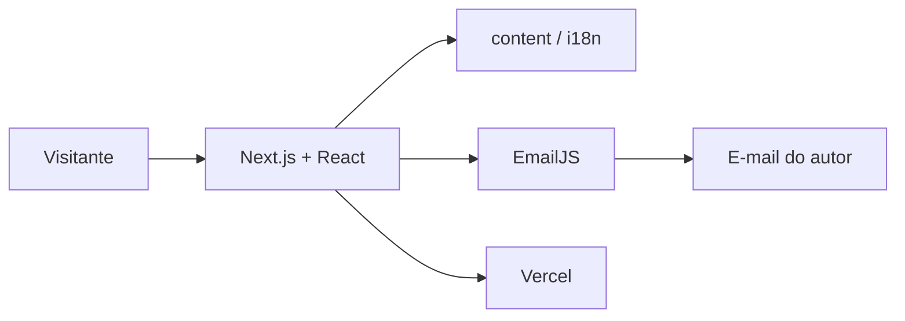
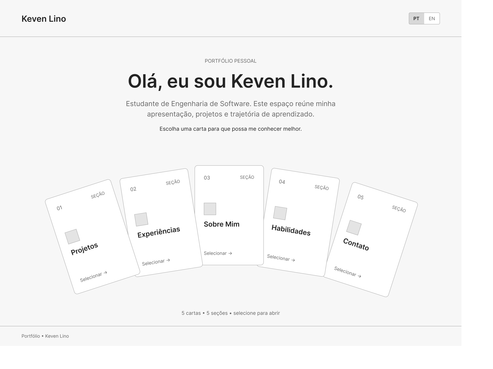
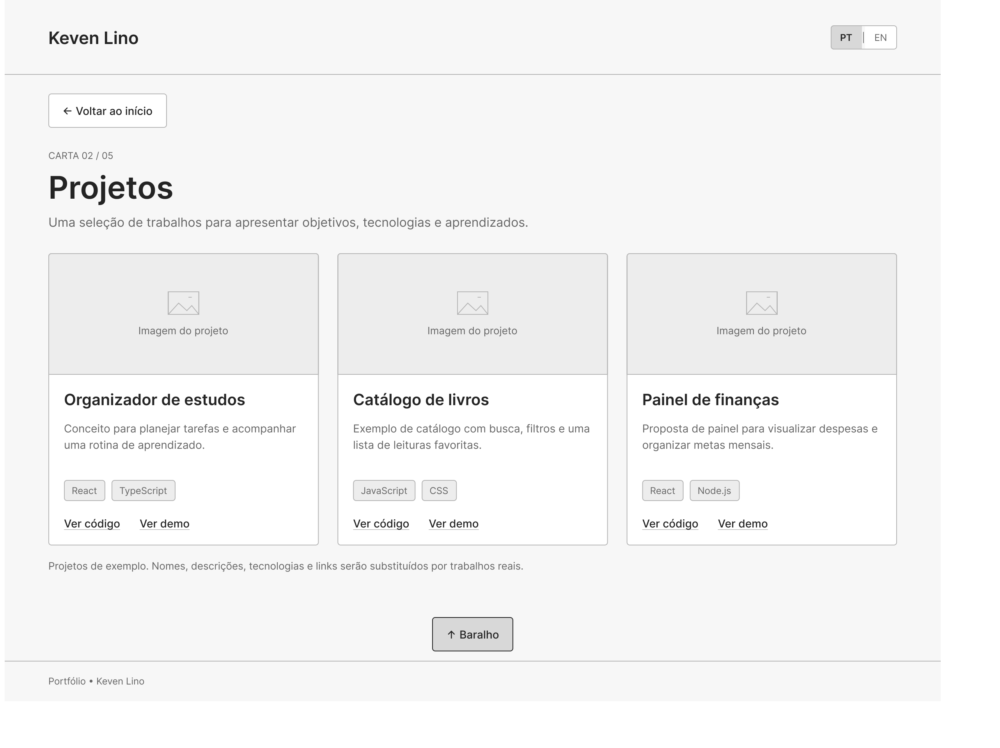
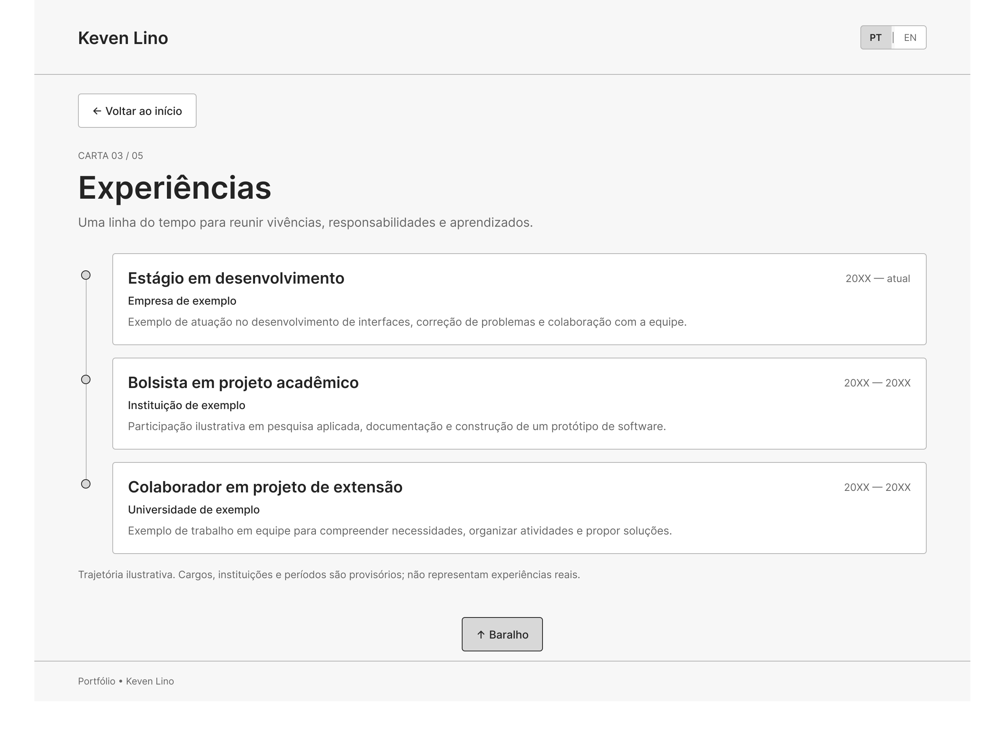
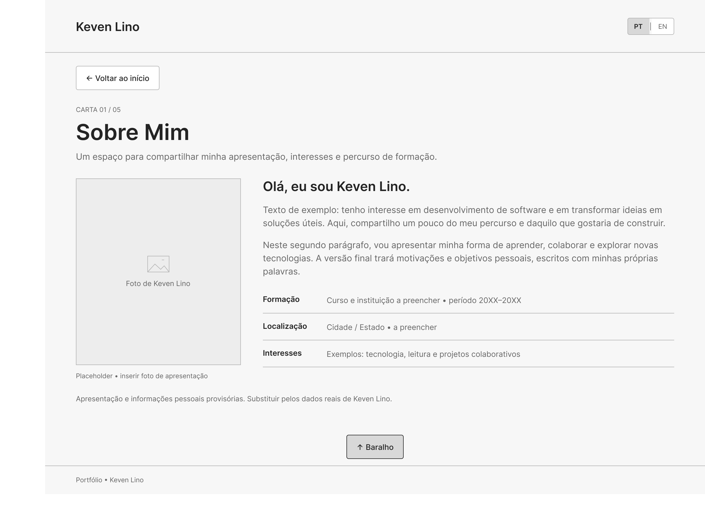
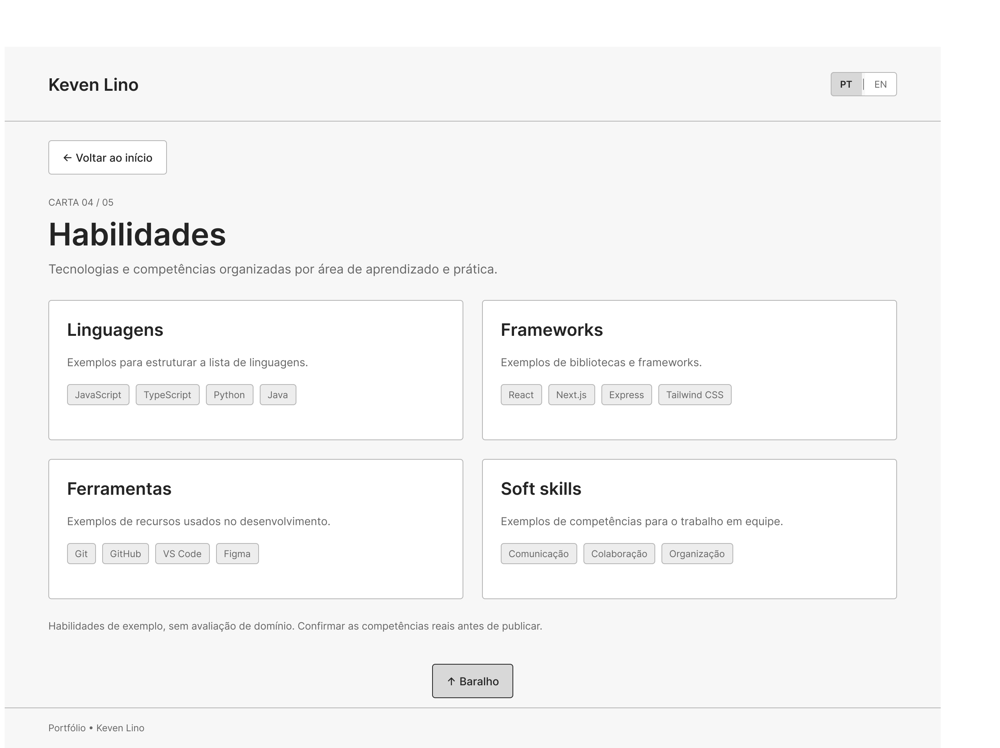
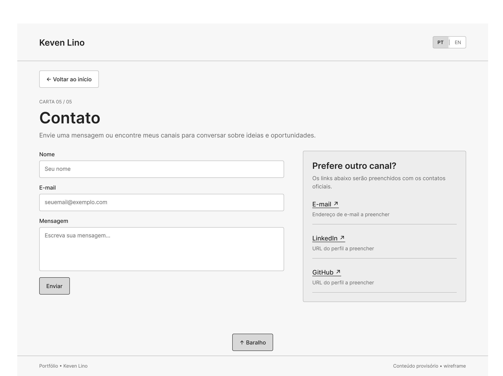
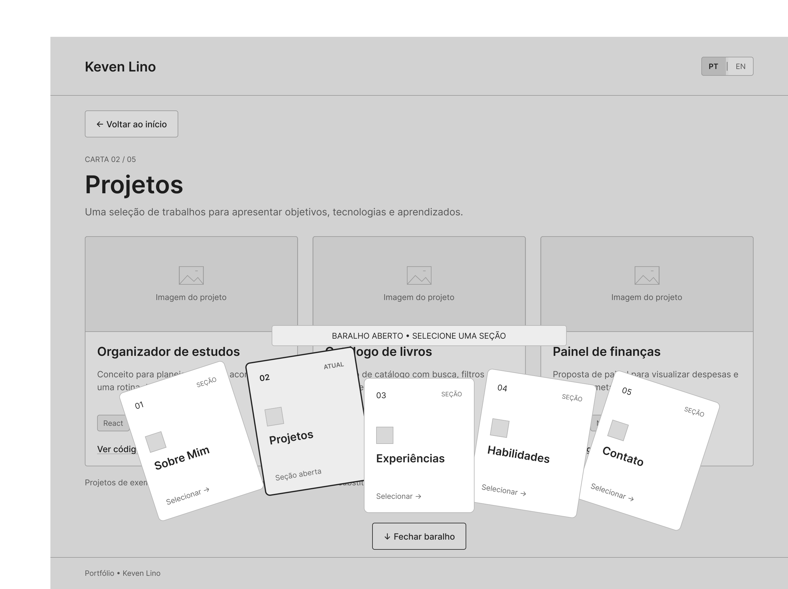

<!-- README do Lab 01 — Portfólio Profissional (DIAW). Baseado no template do Prof. Dr. João Paulo Aramuni. -->

---

# 🃏 Portfólio Profissional — Keven Lino 👨‍💻

> [!NOTE]
> Website de portfólio pessoal para apresentar trajetória, habilidades, projetos e formas de contato, com navegação em **baralho de cartas** e conteúdo em **português e inglês**.

<table>
  <tr>
    <td width="800px">
      <div align="justify">
        Este repositório contém o <b>Laboratório 01</b> da disciplina <b>DIAW — Desenvolvimento e Integração de Aplicações Web</b> (Engenharia de Software). O produto é um site de portfólio profissional de <b>Keven Lino</b>, com seções <i>Sobre Mim</i>, <i>Projetos</i>, <i>Experiências</i>, <i>Habilidades</i> e <i>Contato</i>. A identidade visual segue o protótipo de média fidelidade: um baralho na home; cada carta abre uma seção. O sistema será <b>responsivo</b>, publicado em nuvem (Vercel) e documentado neste README, que segue o <a href="https://github.com/joaopauloaramuni/desenvolvimento-e-integracao-de-aplicacoes-web/blob/main/TEMPLATES/template_README.md">template acadêmico</a> do Prof. Dr. João Paulo Aramuni.
      </div>
    </td>
    <td>
      <div>
        
      </div>
    </td>
  </tr>
</table>

---

## 🚧 Status do Projeto

**Sprint atual: Lab01S01 — Planejamento e prototipação**

[](https://github.com/Tuzfi/Portfolio)
[](https://github.com/Tuzfi/Portfolio)


| Sprint | Foco | Pontos | Situação |
| :--- | :--- | :---: | :--- |
| **Lab01S01** | README, wireframes, protótipo de layout e navegação | 4 | Em andamento (README + protótipos nesta entrega) |
| **Lab01S02** | Seções, PT/EN, timeline, formulário e responsividade | 4 | Pendente |
| **Lab01S03** | Deploy, GIFs reais, polimento e README final | 7 | Pendente |

---

## 📚 Índice
- [Links Úteis](#-links-úteis)
- [Sobre o Projeto](#-sobre-o-projeto)
- [Funcionalidades Principais](#-funcionalidades-principais)
- [Tecnologias Utilizadas](#-tecnologias-utilizadas)
- [Arquitetura](#-arquitetura)
- [Instalação e Execução](#-instalação-e-execução)
- [Deploy](#-deploy)
- [Estrutura de Pastas](#-estrutura-de-pastas)
- [Demonstração](#-demonstração)
- [Testes](#-testes)
- [Documentações utilizadas](#-documentações-utilizadas)
- [Autores](#-autores)
- [Contribuição](#-contribuição)
- [Agradecimentos](#-agradecimentos)
- [Licença](#-licença)

---

## 🔗 Links Úteis
* 🌐 **Demo Online:** *será publicado na Sprint 03 (Vercel).*
  > 💻 **Descrição:** URL de produção do portfólio. Atualizar aqui após o deploy.
* 🎨 **Protótipos (Figma / wireframes):** [docs/prototipos](./docs/prototipos)
  > 📐 **Descrição:** Prints das telas de média fidelidade (home em baralho, seções e navegação).
* 📘 **Enunciado do laboratório:** Laboratório 01 — Portfólio Profissional (DIAW).
* 📖 **Template de README:** [template_README.md](https://github.com/joaopauloaramuni/desenvolvimento-e-integracao-de-aplicacoes-web/blob/main/TEMPLATES/template_README.md)

---

## 📝 Sobre o Projeto

O **Portfólio Profissional** existe para reunir, em um único site, a apresentação de **Keven Lino**, estudante de Engenharia de Software: formação, projetos, experiências, competências e canais de contato.

- **Por que existe:** atender ao Lab 01 da disciplina DIAW e, ao mesmo tempo, publicar um portfólio real, utilizável em processos seletivos e networking.
- **Qual problema resolve:** hoje essas informações ficam espalhadas (currículo, GitHub, redes). O site concentra a narrativa profissional com visual coerente e navegação clara.
- **Contexto:** acadêmico (PUC Minas / Engenharia de Software — DIAW) e pessoal (marca profissional).
- **Onde será usado:** apresentação da Sprint 03, envio em processos seletivos e acesso público após o deploy.

A metáfora do **baralho** diferencia o portfólio de um site de seções empilhadas: o visitante escolhe uma carta, lê o conteúdo e volta ao baralho. O conteúdo será bilingue (**PT | EN**) desde o cabeçalho.

> [!NOTE]
> Na Sprint 01 o código da aplicação ainda não foi gerado. Esta entrega cobre repositório, README, protótipos e a estrutura prevista do site.

---

## ✨ Funcionalidades Principais

- 🃏 **Home em baralho:** cinco cartas (Sobre Mim, Projetos, Experiências, Habilidades, Contato) com seleção para abrir a seção.
- 🧭 **Navegação persistente:** cabeçalho com nome, alternância PT/EN, botão de voltar ao início e atalho “Baralho”.
- 🇧🇷🇺🇸 **Internacionalização:** textos das seções em português e inglês.
- 👤 **Sobre Mim:** apresentação, formação, localização, interesses e foto.
- 📁 **Projetos em timeline:** do mais antigo ao mais recente, com nome, descrição, tecnologias, link do GitHub e imagem/GIF.
- 💼 **Experiências:** empresa/instituição, cargo ou atividade, período e descrição.
- 🧩 **Habilidades:** linguagens, frameworks, ferramentas e soft skills (carta extra do protótipo).
- ✉️ **Contato:** ícones clicáveis (e-mail, LinkedIn, GitHub, WhatsApp) e formulário (nome, e-mail, mensagem) com envio por e-mail.
- ✅ **Validação e responsividade:** checagem básica do formulário e layout adaptado a desktop e mobile.
- ☁️ **Hospedagem:** publicação gratuita em nuvem (Vercel).

---

## 🛠 Tecnologias Utilizadas

Stack **prevista** para as Sprints 01–03 (versões serão fixadas no `package.json` na Parte 2).

### 💻 Front-end

* **Framework:** [Next.js](https://nextjs.org/) (App Router)
* **Biblioteca de UI:** [React](https://react.dev/)
* **Linguagem:** [TypeScript](https://www.typescriptlang.org/)
* **Estilização:** [Tailwind CSS](https://tailwindcss.com/)
* **Animações (opcional):** [Framer Motion](https://www.framer.com/motion/)
* **Formulários:** [React Hook Form](https://react-hook-form.com/)

### 🖥️ Integrações (sem back-end próprio)

O enunciado pede front-end, back-end e nuvem. Neste projeto o “back-end” da Sprint 02 será o **envio de e-mail pelo formulário**, sem API Spring/Node própria:

* **Envio de e-mail:** [EmailJS](https://www.emailjs.com/) (do front-end, com chaves públicas de serviço)
* **Conteúdo:** arquivos TypeScript/JSON em `src/content` (projetos, experiências, i18n)

### ⚙️ Infraestrutura & DevOps

* **Cloud / Hosting:** [Vercel](https://vercel.com/)
* **Versionamento:** [Git](https://git-scm.com/) + [GitHub](https://github.com/Tuzfi/Portfolio)
* **Prototipação:** [Figma](https://www.figma.com/)

---

## 🏗 Arquitetura

Arquitetura **front-end monolítica** no Next.js, com conteúdo estático versionado e um serviço externo (EmailJS) para o formulário. Foi escolhida por:

- alinhar-se ao deploy gratuito na Vercel;
- ser suficiente para portfólio (não há autenticação nem banco);
- permitir PT/EN e as seções do baralho com rotas simples.

**Componentes principais**

| Camada | Papel |
| :--- | :--- |
| `app/` | Rotas (`/`, `/sobre`, `/projetos`, `/experiencias`, `/habilidades`, `/contato`) e layout (header/footer) |
| `components/` | Baralho, cartas, timeline, formulário, seletor de idioma |
| `content/` | Dados reais (textos PT/EN, projetos, experiências) |
| EmailJS | Envio da mensagem de contato |
| Vercel | Build, preview e produção |



**Decisão:** não haverá PostgreSQL, Spring Boot nem Docker nesta versão. Se o formulário exigir um endpoint próprio depois, uma Route Handler do Next.js pode ser adicionada sem mudar o restante do site.

---

## 🔧 Instalação e Execução

> [!IMPORTANT]
> Os comandos abaixo valem **depois** da Parte 2 (scaffold do Next.js). Nesta Sprint 01 o repositório contém documentação e protótipos.

### Pré-requisitos

* **Node.js:** LTS (v20 ou superior)
* **npm** (vem com o Node.js)
* **Git**
* Conta no **EmailJS** (Sprint 02) e na **Vercel** (Sprint 03)

### 🔑 Variáveis de Ambiente

Arquivo **`.env.local`** na raiz da aplicação (não versionado). Exemplo previsto:

```
NEXT_PUBLIC_EMAILJS_SERVICE_ID=seu_service_id
NEXT_PUBLIC_EMAILJS_TEMPLATE_ID=seu_template_id
NEXT_PUBLIC_EMAILJS_PUBLIC_KEY=sua_public_key
```

Na Vercel: *Project Settings → Environment Variables*, com os mesmos nomes.

### 📦 Instalação de Dependências

```bash
git clone https://github.com/Tuzfi/Portfolio.git
cd Portfolio
npm install
```

### ⚡ Como Executar a Aplicação

```bash
npm run dev
```

🎨 *A aplicação ficará em **http://localhost:3000** (porta padrão do Next.js).*

```bash
npm run build
npm run start
```

---

## 🚀 Deploy

Hospedagem prevista: **Vercel** (adequada ao Next.js e ao preview pedido na Sprint 02).

1. Conectar o repositório `Tuzfi/Portfolio` na Vercel.
2. Framework preset: **Next.js**.
3. Configurar as variáveis `NEXT_PUBLIC_EMAILJS_*`.
4. Cada push em `main` gera produção; pull requests geram Preview.

O link público entra na seção [Links Úteis](#-links-úteis) na Sprint 03.

---

## 📂 Estrutura de Pastas

Estado **atual** (Sprint 01) e pasta **prevista** para o código (Partes 2 em diante).

```
.
├── .gitignore                 # 🧹 Ignora node_modules, .next, .env.local
├── README.md                  # 📘 Documentação do laboratório
├── docs/
│   ├── assets/
│   │   └── logo.svg           # 🎨 Marca do portfólio (baralho + KL)
│   └── prototipos/
│       ├── 01-home-baralho.png
│       ├── 02-projetos.png
│       ├── 03-experiencias.png
│       ├── 04-sobre-mim.png
│       ├── 05-habilidades.png
│       ├── 06-contato.png
│       ├── 07-navegacao-baralho-aberto.png
│       └── wireframes-figma.pdf
│
├── public/                    # 📂 (previsto) fotos, GIFs dos projetos, ícones
├── src/                       # 📂 (previsto) código-fonte Next.js
│   ├── app/                   # 📄 Rotas e layout principal
│   ├── components/            # 🧱 Header, Footer, Deck, Card, Form
│   ├── content/               # 📝 Textos PT/EN, projetos, experiências
│   └── lib/                   # 🛠️ i18n, tipos, EmailJS
├── package.json               # 📦 (previsto) dependências e scripts
└── tsconfig.json              # 🔷 (previsto) TypeScript
```

---

## 🎥 Demonstração

Nesta Sprint 01 a demonstração são os **wireframes de média fidelidade**. Prints da aplicação real entram nas Sprints 02 e 03.

### 🌐 Aplicação Web — protótipos

| Tela | Captura |
| :---: | :---: |
| **Home (baralho)** | **Projetos** |
|  |  |
| **Experiências** | **Sobre Mim** |
|  |  |
| **Habilidades** | **Contato** |
|  |  |

**Navegação — baralho aberto sobre a seção atual**



> [!WARNING]
> Os textos, projetos e experiências dos wireframes são **placeholder**. Serão substituídos por dados reais nas Sprints 02 e 03.

---

## 🧪 Testes

Ainda não há suíte automatizada na Sprint 01. Planejamento:

* **Sprint 02:** verificação manual das rotas, PT/EN, formulário e breakpoints.
* **Opcional:** testes de componentes com Vitest / Testing Library; E2E com Playwright nas rotas principais.

```bash
npm run test        # a definir após o scaffold
npm run test:e2e    # a definir, se houver E2E
```

---

## 🔗 Documentações utilizadas

* 📖 [Next.js](https://nextjs.org/docs)
* 📖 [React](https://react.dev/)
* 📖 [Tailwind CSS](https://tailwindcss.com/docs)
* 📖 [React Hook Form](https://react-hook-form.com/)
* 📖 [EmailJS](https://www.emailjs.com/docs/)
* 📖 [Vercel](https://vercel.com/docs)
* 📖 [Template de README — Prof. João Paulo Aramuni](https://github.com/joaopauloaramuni/desenvolvimento-e-integracao-de-aplicacoes-web/blob/main/TEMPLATES/template_README.md)
* 🎨 Exemplos de portfólio citados no enunciado: [Flávio Júnior](https://flaviojunior-portfolio.vercel.app/), [Gabriel Victor](https://gabrielvictor.web.app/), [Pedro Braga](https://www.pedrobragadev.com/), [Luca Azalim](https://azal.im/)

---

## 👥 Autores

| 👤 Nome | 🖼️ Foto | :octocat: GitHub | 💼 LinkedIn |
|---------|----------|-----------------|-------------|
| Keven Lino | <div align="center"></div> | <div align="center"><a href="https://github.com/Tuzfi">Tuzfi</a></div> | <div align="center">a preencher</div> |

---

## 🤝 Contribuição

Este é um trabalho acadêmico individual. Mesmo assim, o fluxo abaixo vale para organização das partes:

1. Trabalhe em `main` ou em branches por sprint (`s01-layout`, `s02-secoes`, `s03-deploy`).
2. Use [Conventional Commits](https://www.conventionalcommits.org/en/v1.0.0/) quando possível (`feat:`, `docs:`, `chore:`).
3. Abra Pull Request apenas se o fluxo da disciplina pedir revisão.

---

## 🙏 Agradecimentos

* [**Engenharia de Software PUC Minas**](https://www.instagram.com/engsoftwarepucminas/) — contexto acadêmico do laboratório.
* [**Prof. Dr. João Paulo Aramuni**](https://github.com/joaopauloaramuni) — enunciado do Lab 01, template de README e referências de stack.
* Exemplos de portfólio listados no enunciado, usados como referência de qualidade visual (não como cópia de layout).

---

## 📄 Licença

Uso acadêmico (Lab 01 — DIAW). O código neste repositório pode ser redistribuído para fins de avaliação da disciplina. Licença formal (MIT) pode ser adicionada na Sprint 03, se desejado.

---
